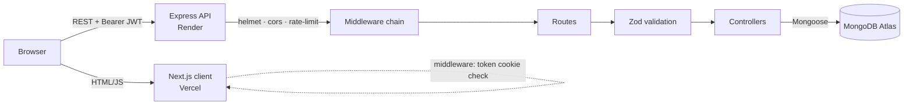
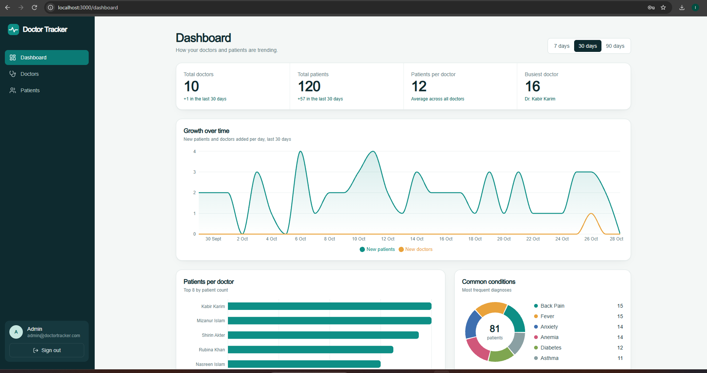
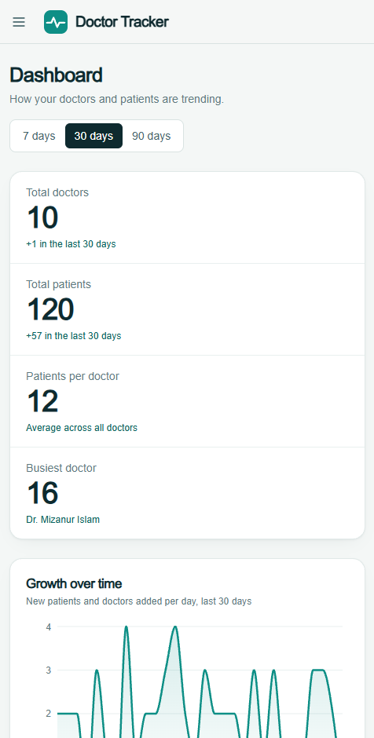

# Doctor Tracker

## Elevator pitch
Doctor Tracker is a secure admin portal for managing doctors and the patients assigned to them. Administrators sign in, add and organise doctors, attach patients to a doctor, and search/filter/paginate every list. A dashboard turns the data into clear analytics (totals, patients per doctor, growth over time, conditions, age and gender mix). The system is two separately deployable apps: a **Next.js** client and a standalone **Node.js + Express** REST API backed by **MongoDB**.

```
doctor-tracker/
├── backend/    Express REST API  (Mongoose, JWT, Zod)
├── frontend/   Next.js 14 App Router client (Tailwind, TanStack Query, Recharts)
└── docs/       screenshots
```
Both folders are independent projects, so each can be pushed to its own GitHub repository as the task requires.

## Setup guide

**Prerequisites:** Node.js 18+, a MongoDB instance (local, or a free MongoDB Atlas cluster).

### 1. Backend
```bash
cd backend
cp .env.example .env        # then edit MONGODB_URI and JWT_SECRET
npm install
npm run seed                # optional: 10 doctors + 120 patients + admin user
npm run dev                 # http://localhost:5000
```
`.env.example`
```
PORT=5000
MONGODB_URI=mongodb://127.0.0.1:27017/doctor_tracker
JWT_SECRET=change-me-to-a-long-random-string
JWT_EXPIRES_IN=1d
CLIENT_ORIGIN=http://localhost:3000
ADMIN_EMAIL=admin@doctortracker.com
ADMIN_PASSWORD=Admin@123
```
If the database has no users, the server creates the admin from `ADMIN_EMAIL` / `ADMIN_PASSWORD` on first boot, so a fresh production deploy is usable immediately.

### 2. Frontend
```bash
cd frontend
cp .env.example .env.local  # NEXT_PUBLIC_API_URL=http://localhost:5000/api
npm install
npm run dev                 # http://localhost:3000
```

**Demo login:** `admin@doctortracker.com` / `Admin@123`

### 3. Deployment
- **Backend → Render (free):** New Web Service → root directory `backend` → build `npm install` → start `npm start`. Set env vars `MONGODB_URI` (Atlas), `JWT_SECRET`, `CLIENT_ORIGIN` (your Vercel URL, no trailing slash), `ADMIN_EMAIL`, `ADMIN_PASSWORD`, `NODE_ENV=production`. Free instances sleep, so the first request after idle can take ~30s.
- **Frontend → Vercel:** import the repo, root directory `frontend`, set `NEXT_PUBLIC_API_URL=https://<your-render-app>.onrender.com/api`.
- Atlas: allow access from `0.0.0.0/0` (Network Access) for Render's dynamic IPs.
- To seed demo data in production run `npm run seed` locally with `MONGODB_URI` pointing at Atlas (note: seed clears doctors and patients).

## System architecture



**Request flow**
1. `POST /api/auth/login` validates credentials (bcrypt) and returns a signed JWT. The client stores it in a cookie.
2. Next.js `middleware.js` redirects visitors without the cookie to `/login` (and signed-in users away from it). This is for routing/UX only.
3. Every API call sends `Authorization: Bearer <jwt>`. `protect` verifies the token and loads the user; `authorize('admin')` enforces the role. An expired/invalid token returns 401 and the client's axios interceptor clears the session and redirects to `/login`.
4. Controllers talk to MongoDB through Mongoose and return `{ data, meta }`; all errors pass through one error handler that returns `{ message, details }` (field-level `details` map directly to form fields).

**Data model**
- `User` – name, email (unique), bcrypt-hashed password, role.
- `Doctor` – name, specialization, hospital, phone, email (unique).
- `Patient` – name, age, gender, phone, email, condition, `doctor` (ref → Doctor).

**API (all under `/api`, all protected except login and health)**

| Method | Path | Purpose |
|---|---|---|
| POST | `/auth/login` | Sign in |
| GET | `/auth/me` | Current user |
| GET | `/dashboard?days=7\|30\|90` | Aggregated analytics |
| GET/POST | `/doctors` | List (search, filters, sort, pagination) / create |
| GET | `/doctors/facets`, `/doctors/options` | Filter values / lightweight select list |
| GET/PUT/DELETE | `/doctors/:id` | Read / update / delete (cascades to patients) |
| GET/POST | `/doctors/:id/patients` | A doctor's patients / add patient under doctor |
| DELETE | `/doctors/:id/patients/:patientId` | Remove patient from doctor |
| GET/POST | `/patients` | List (search, condition, gender, doctor, date range, sort, pagination) / create |
| PUT/DELETE | `/patients/:id` | Edit / delete |

List endpoints accept `page`, `limit` (max 50), `search`, `from`/`to` (created date), `sort` (`newest|oldest|name`) plus resource-specific filters.

## Technical decisions

### 1. Compound indexes + server-side pagination (instead of fetching everything and filtering in the browser)
Lists can grow to thousands of rows, so filtering, sorting and paging happen in MongoDB. Indexes follow the *equality → sort* rule of the queries actually issued:
- `Patient {doctor:1, createdAt:-1}` serves "a doctor's patients, newest first" and the per-doctor counts.
- `Patient {condition:1, createdAt:-1}`, `{gender:1, createdAt:-1}`, `{createdAt:-1}` serve the filters, date ranges and the dashboard time series.
- `Doctor {specialization:1, createdAt:-1}`, `{hospital:1, createdAt:-1}`, `{createdAt:-1}` do the same for doctors.

Other efficiency choices: `.lean()` reads, `Promise.all` for `find` + `countDocuments`, a capped page size, and **one grouped aggregation for the patient counts of the current page of doctors** instead of one count query per row (no N+1). On the client, TanStack Query with `keepPreviousData` keeps the table stable while paging, and search input is debounced (350 ms) so typing doesn't fire a request per keystroke.
*Trade-off:* the search box uses an escaped, case-insensitive substring regex across several fields so partial matches work ("rah" finds "Rahim"). A leading-wildcard regex cannot use an index efficiently, so at very large scale the next step would be MongoDB Atlas Search or a text index; the filters and sort remain index-backed and `limit` is capped, so the cost stays bounded.

### 2. Dashboard analytics computed with MongoDB aggregation, delivered in a single request
Rather than shipping raw records to the browser, `GET /dashboard` runs independent aggregations in parallel (`$group`, `$dateToString`, `$lookup`, `$bucket`, `$sort/$limit`) and returns chart-ready JSON: totals, per-day timeline (gaps zero-filled server-side so the chart axis is continuous), top doctors by patient count, condition and specialization breakdowns, age buckets and gender split. The payload is small and constant-size regardless of how many records exist, the browser only renders, and the date-bounded `$match` stages use the `createdAt` indexes. Chart components are wrapped in `React.memo`, so switching the 7/30/90-day range re-renders only what changed. Totals use `estimatedDocumentCount()` (metadata, O(1)).

### Also worth knowing
- **Auth storage:** the JWT lives in a (non-httpOnly) cookie so that Next middleware can gate routes and the SPA can attach the Bearer header across origins (Vercel ↔ Render). The trade-off is exposure to XSS versus httpOnly cookies; mitigations are `helmet`, strict input validation, no `dangerouslySetInnerHTML`, and a 1-day token lifetime. A production hardening step would be httpOnly cookies behind a shared parent domain.
- **Security:** bcrypt (cost 12), login rate limiting, CORS allow-list, helmet, 100 kb body limit, Zod validation on every write, generic login error (no user enumeration).
- **Deleting a doctor** deletes their patients so no orphan records remain; the confirmation dialog states how many will be removed.

## Visual evidence
Screenshots (desktop and mobile) go in `docs/screenshots/` – see the list in that folder, then embed them here, e.g.:

```md


```

## Feature checklist
- [x] JWT login, protected routes (Next middleware + API guard + role check)
- [x] Doctors: create, edit, delete, list, search, filter (specialization, hospital, date range), sort, paginate
- [x] Doctor detail: patients list (paginated), add patient under doctor, remove patient
- [x] Patients page: list, edit, delete, add, search, filter (condition, gender, doctor, date range), sort, paginate
- [x] Dashboard: totals, patients per doctor, date-based statistics, conditions, age/gender, recent patients
- [x] Responsive layout (mobile drawer navigation), loading/empty/error states, toasts, accessible dialogs
